<!--
  ═══════════════════════════════════════════════════════════════════
  MUHAMMAD HATEEM HUSSAIN — GitHub Profile README (v2)
  Rebuilt 14 Nov 2026 following the reference profile structure,
  recreated for Hateem — NOT copied. All 18 visuals are hand-built
  SVGs in assets/ (Midnight Gold). All numbers are verified facts
  from his CV / real GitHub data — nothing invented.

  PALETTE — MIDNIGHT GOLD (locked, more gold)
    Background  #0B0F1A   Deep        #05070D
    Gold        #D4A017   Bright gold #F5C518
    Light gold  #F0D060   Dark gold   #8C6D1F
    Text        #FFF8E1   Muted       #A8A08A
    Stats params: bg_color=0B0F1A&title_color=D4A017
                  &text_color=FFF8E1&icon_color=F5C518&border_color=D4A017

  PUBLISH NOTE — preview only, NOT pushed to the profile repo yet.
  At publish time this file goes to Hateem-Hussain-01/Hateem-Hussain-01
  as README.md, with the 18 SVGs in assets/ beside it. The portfolio
  repo (hateem-portfolio) is private until Eman approves — its links
  below return 404 until it goes public.
  ═══════════════════════════════════════════════════════════════════
-->

<a href="https://github.com/Hateem-Hussain-01/hateem-portfolio">
  
</a>

  
  
  
  



<a href="https://github.com/Hateem-Hussain-01/codebettle.web"></a>

  
  

<a href="https://github.com/Hateem-Hussain-01/global-study-abroad-platform"></a>

  
  

<a href="https://github.com/Hateem-Hussain-01/safesubmit"></a>

  

<a href="https://github.com/Hateem-Hussain-01/Zero_Day_Attact"></a>

  



  

<a href="https://github.com/Hateem-Hussain-01/hateem-portfolio"></a>

> **Also verified:** Generative AI Application Developer — **Cohort 1 Top Performer** (from my CV).


  
  
  
  
  
  

